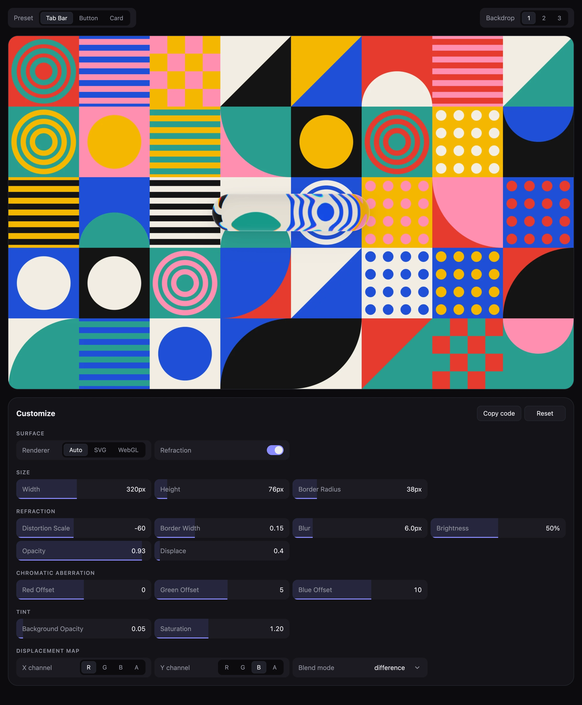

<h1 align="center">Glass Surface</h1>

<p align="center">Refractive liquid glass for the web and React.</p>

<p align="center">
  <a
    href="https://github.com/svidskiy/glass-surface/actions/workflows/ci.yml"
  ></a>
  <a
    href="LICENSE"
  ></a>
  
</p>

<p align="center">
  <a href="https://glass-surface.svidware.workers.dev">Playground</a> ·
  <a href="#install">Install</a> ·
  <a href="#usage">Usage</a> ·
  <a href="#renderers">Renderers</a> ·
  <a href="CONTRIBUTING.md">Contributing</a>
</p>



**Put real refraction behind any element.** The surface bends what lies
behind it at the edge, splits the colors like a lens, and keeps the center
calm, in React or in plain JavaScript.

<table>
  <thead>
    <tr>
      <td
        width="33%"
        valign="top"
      ><b>WebGL</b><br>Refracts an image, video, or canvas with smooth
        sampling, at any device pixel ratio.</td>
      <td
        width="33%"
        valign="top"
      ><b>SVG filter</b><br>Refracts whatever DOM is behind the element
        through <code>backdrop-filter</code> in Chromium.</td>
      <td
        width="33%"
        valign="top"
      ><b>Frosted fallback</b><br>Blur, tint, and a rim light wherever
        refraction isn't available.</td>
    </tr>
  </thead>
  <tbody>
    <tr>
      <td valign="top"><b>Any shape</b><br>The alpha channel of an image
        becomes the outline, with a bevel that follows it.</td>
      <td valign="top"><b>Chromatic aberration</b><br>Each color channel
        bends by its own amount.</td>
      <td valign="top"><b>Any framework</b><br>One core for JavaScript and
        TypeScript, and a React component on top.</td>
    </tr>
  </tbody>
</table>

## Install

```sh
bun add @svidskiy/glass-surface-react
```

Without React, install the core instead:

```sh
bun add @svidskiy/glass-surface
```

## Usage

```tsx
import "@svidskiy/glass-surface-react/style.css";
import { GlassSurface } from "@svidskiy/glass-surface-react";
import { useRef } from "react";

export function TabBar() {
  const photo = useRef<HTMLImageElement>(null);

  return (
    <>
      

      <GlassSurface backdrop={photo} borderRadius={38} height={76} width={320}>
        …
      </GlassSurface>
    </>
  );
}
```

The [playground](https://glass-surface.svidware.workers.dev) tunes every
option and copies the JSX. [Core](packages/core) shows the same surface
without React.

## Renderers

| Renderer | Refracts | Where |
| --- | --- | --- |
| WebGL | The `backdrop`: an ``, `<video>`, or `<canvas>` | Every browser with WebGL 2 |
| SVG | Any content behind the element | Chromium |
| Fallback | Nothing; frosted glass | Everywhere else |

`renderer: "auto"` uses WebGL when a `backdrop` is given and the SVG filter
otherwise.

## Packages

| Package | What it is |
| --- | --- |
| [`@svidskiy/glass-surface`](packages/core) | The framework-free core for JavaScript and TypeScript |
| [`@svidskiy/glass-surface-react`](packages/react) | The React component |

## Contributing

Pull requests are welcome. [CONTRIBUTING.md](CONTRIBUTING.md) covers the
setup, the checks CI runs, and the conventions, and
[Releasing](docs/releasing.md) covers releases. Report vulnerabilities
privately as described in [SECURITY.md](SECURITY.md).

## License

Glass Surface is licensed under the MIT license, whose text is in
[LICENSE](LICENSE).
