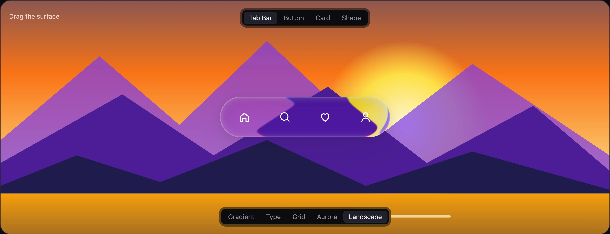
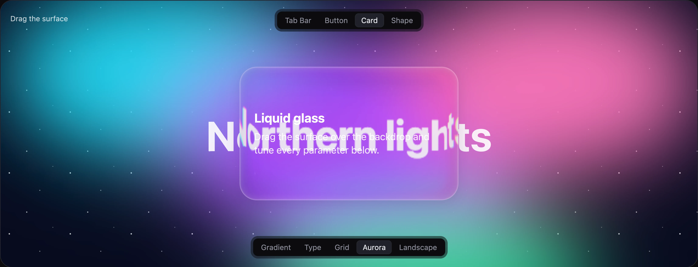
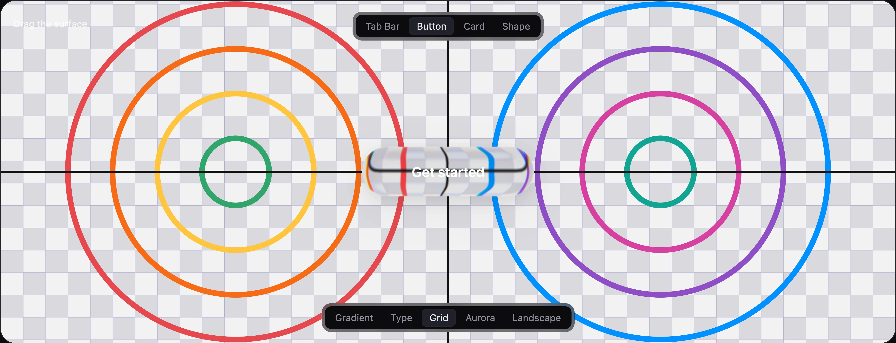
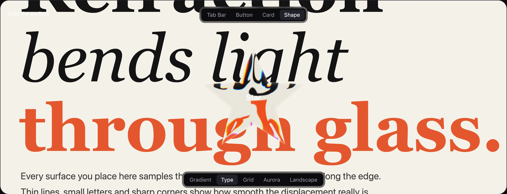

# Glass Surface

Refractive glass for the web: an SVG backdrop filter, a WebGL renderer and a frosted fallback.

**[Open the playground →](https://glass-surface.svidware.workers.dev)**



| Card | Button | Custom shape |
| --- | --- | --- |
|  |  |  |

## Packages

| Package | Description |
| --- | --- |
| [`@svidskiy/glass-surface`](packages/core) | Framework-free core for JavaScript and TypeScript |
| [`@svidskiy/glass-surface-react`](packages/react) | React component |

## Playground

[glass-surface.svidware.workers.dev](https://glass-surface.svidware.workers.dev): drag the surface over five backdrops and tune every option; **Copy code** copies the JSX.


## Development

```sh
bun install
bun run dev        # playground at http://localhost:5173
bun run check      # Ultracite (Biome)
bun run typecheck
bun run build
bun run deploy     # playground to Cloudflare Workers
```

Releases go through Changesets: `bun run changeset`, then `bun run version-packages` and `bun run release`.

## License

[MIT](LICENSE)
