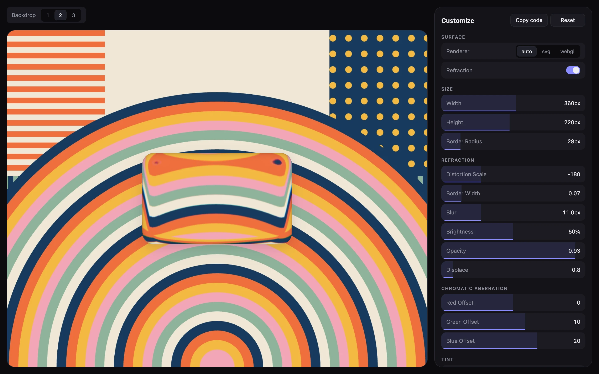

# Glass Surface

Refractive liquid glass for the web and React.

[](https://github.com/imsvidskiy/glass-surface/actions/workflows/ci.yml)
[](https://www.npmjs.com/package/@imsvidskiy/glass-surface)
[](LICENSE)

The surface bends what lies behind it at the edge, splits the colors like a
lens, and keeps the center calm. Try it in the
[playground](https://glass-surface.svidware.workers.dev).



## Features

- **Refraction in every browser.** An SVG filter refracts the page in
  Chromium, WebGL refracts an image, video, or canvas everywhere else, and
  frosted glass covers the rest.
- **Any shape.** The alpha channel of an image becomes the outline, with a
  bevel that follows it.
- **Chromatic aberration.** Each color channel bends by its own amount.
- **Any framework.** One core for JavaScript and TypeScript, and a React
  component on top.

## Install

```sh
npm install @imsvidskiy/glass-surface-react
```

Without React, install `@imsvidskiy/glass-surface`. pnpm, Yarn, and Bun work
the same way.

## Usage

With React 19:

```tsx
import "@imsvidskiy/glass-surface-react/style.css";
import { GlassSurface } from "@imsvidskiy/glass-surface-react";
import { useRef } from "react";

export function TabBar() {
  const photoRef = useRef<HTMLImageElement>(null);

  return (
    <>
      

      <GlassSurface backdrop={photoRef} borderRadius={38} height={76} width={320}>
        …
      </GlassSurface>
    </>
  );
}
```

Without a framework:

```ts
import "@imsvidskiy/glass-surface/style.css";
import { createGlassSurface } from "@imsvidskiy/glass-surface";

const surface = createGlassSurface(document.querySelector("#panel"), {
  backdrop: document.querySelector("#photo"),
});

surface.update({ distortionScale: -90 });
surface.destroy();
```

## Options

Every option is a prop of the React component and a key of the object that
`createGlassSurface` and `update` take.

| Option | Type | Default | What it sets |
| --- | --- | --- | --- |
| `backdrop` | element, ref, or `null` | `null` | The ``, `<video>`, or `<canvas>` behind the surface, or a ref to it. WebGL refracts it. |
| `backgroundOpacity` | number | `0` | Opacity of the tint, from 0 to 1. |
| `blueOffset` | number | `20` | Extra displacement of the blue channel. |
| `blur` | number | `11` | Softness of the transition between the edge and the center, in pixels. |
| `borderRadius` | number | `20` | Corner radius, in pixels. |
| `borderWidth` | number | `0.07` | Width of the refracting edge, as a fraction of the shorter side. |
| `brightness` | number | `50` | Lightness of the flat center of the displacement map, from 0 to 100. |
| `displace` | number | `0.8` | Blur of the refracted result, in pixels. |
| `distortionScale` | number | `-180` | Strength of the displacement. |
| `greenOffset` | number | `10` | Extra displacement of the green channel. |
| `mixBlendMode` | CSS blend mode | `"difference"` | Blend mode of the vertical gradient in the displacement map. |
| `opacity` | number | `0.93` | How strongly the flat center overrides the edge gradient, from 0 to 1. |
| `redOffset` | number | `0` | Extra displacement of the red channel. |
| `refraction` | boolean | `true` | Turns refraction on. Without it the surface is frosted. |
| `renderer` | `"auto"`, `"svg"`, or `"webgl"` | `"auto"` | The renderer to prefer, as described in [Renderers](#renderers). |
| `saturation` | number | `1` | Saturation multiplier of the refracted backdrop. |
| `shape` | URL or `null` | `null` | An image whose alpha channel is the outline of the surface. |
| `xChannel` | `"R"`, `"G"`, `"B"`, or `"A"` | `"R"` | Displacement map channel that drives the horizontal shift. |
| `yChannel` | `"R"`, `"G"`, `"B"`, or `"A"` | `"G"` | Displacement map channel that drives the vertical shift. |

The React component adds its own props:

| Prop | Type | Default | What it sets |
| --- | --- | --- | --- |
| `children` | node | none | The content on the glass. |
| `className` | string | none | Extra classes on the surface. |
| `element` | `"div"` or `"span"` | `"div"` | The tag of the surface and its content. Use `"span"` inside phrasing content such as a heading. |
| `height` | CSS height | `80` | Height of the surface. |
| `style` | style object | none | Extra styles on the surface. |
| `width` | CSS width | `200` | Width of the surface. |

## Renderers

| Renderer | Refracts | Where |
| --- | --- | --- |
| SVG | Whatever is behind the element | Chromium |
| WebGL | The `backdrop` | Every browser with WebGL 2 |
| Fallback | Nothing; frosted glass | Everywhere else |

The `renderer` option picks between them:

| `renderer` | Chromium | Other browsers |
| --- | --- | --- |
| `"auto"` | SVG | WebGL with a `backdrop`, the fallback without |
| `"svg"` | SVG | Fallback |
| `"webgl"` | WebGL with a `backdrop`, SVG without | WebGL with a `backdrop`, the fallback without |

Each renderer has limits worth knowing:

- The SVG filter sees only the pixels directly behind the surface, so a strong
  distortion mirrors them at the edge instead of pulling in what lies beyond.
- WebGL reads the `backdrop` pixels, so a cross-origin image, video, or shape
  needs CORS headers and the `crossorigin` attribute.
- Every WebGL surface owns a context, and browsers keep about 16 per page.
  Surfaces beyond that fall back to the SVG filter or to frosted glass.
- A WebGL surface redraws only when the backdrop, the layout, or an option
  changes, and pauses while it is off screen or the tab is hidden.

## Packages

| Package | What it is |
| --- | --- |
| [`@imsvidskiy/glass-surface`](packages/core) | The framework-free core for JavaScript and TypeScript |
| [`@imsvidskiy/glass-surface-react`](packages/react) | The React component |

## Contributing

Pull requests are welcome. [CONTRIBUTING.md](CONTRIBUTING.md) covers the
setup, the checks CI runs, and the conventions, and
[Releasing](docs/releasing.md) covers releases. Report vulnerabilities
privately as described in [SECURITY.md](SECURITY.md).

## License

Glass Surface is licensed under the MIT license, whose text is in
[LICENSE](LICENSE).
