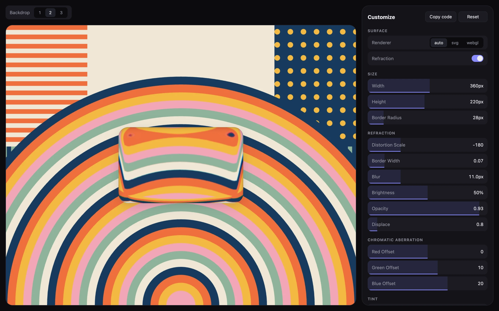

# @imsvidskiy/glass-surface

Refractive liquid glass for any element, without a framework.



## Install

```sh
npm install @imsvidskiy/glass-surface
```

pnpm, Yarn, and Bun work the same way.

## Usage

```ts
import "@imsvidskiy/glass-surface/style.css";
import { createGlassSurface } from "@imsvidskiy/glass-surface";

const surface = createGlassSurface(document.querySelector("#panel"), {
  backdrop: document.querySelector("#photo"),
});

surface.update({ distortionScale: -90 });
surface.destroy();
```

`createGlassSurface` moves the children of the element onto the glass.
`update` merges new options into the current ones, and `destroy` restores the
element.

The [options](https://github.com/imsvidskiy/glass-surface#options) and the
[renderers](https://github.com/imsvidskiy/glass-surface#renderers) are
described in the repository README.

## Building an adapter

The React component is a thin layer over the same exports, and an adapter for
another framework can use them too:

| Export | What it does |
| --- | --- |
| `createGlassSurfaceController` | Holds the options and the state of one surface, measures the mounted element, and drives the WebGL renderer |
| `getSurfaceClasses` | Returns the classes of the surface for a state |
| `getSurfaceProperties` | Returns the CSS custom properties of the surface for the options and a state |
| `describeFilter` | Describes the SVG filter for the options and a state, or returns `null` when the surface doesn't use one |
| `toFilterId` | Turns a unique id into the id of the filter |
| `resolveOptions` and `defaultOptions` | Fill in the options that aren't given |

An adapter renders the markup that the stylesheet expects, inside the mounted
element and in this order:

| Element | Class | When |
| --- | --- | --- |
| `<svg>` with the described `<filter>` | `glass-surface__filter` | While `describeFilter` returns a description |
| `<canvas>` | `glass-surface__canvas` | Always; the WebGL renderer draws on it |
| `<span aria-hidden="true">` | `glass-surface__frame` | Always |
| `<span aria-hidden="true">` | `glass-surface__glow` | Always |
| `<span aria-hidden="true">` | `glass-surface__line` | Always |
| The content | `glass-surface__content` | Always |

It subscribes to the controller with `subscribe`, reads `getState` and
`getOptions` on every change, passes new options to `setOptions`, and calls
`mount` with the element once it is in the document.

## License

MIT
