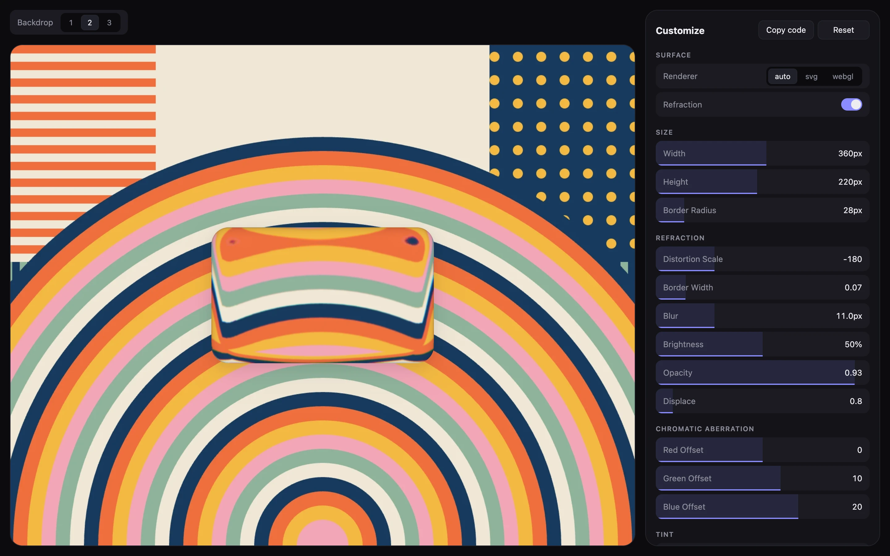

# @imsvidskiy/glass-surface-react

Refractive liquid glass as a React component. Requires React 19.



## Install

```sh
npm install @imsvidskiy/glass-surface-react
```

pnpm, Yarn, and Bun work the same way.

## Usage

```tsx
import "@imsvidskiy/glass-surface-react/style.css";
import { GlassSurface } from "@imsvidskiy/glass-surface-react";
import { useRef } from "react";

export function TabBar() {
  const photoRef = useRef<HTMLImageElement>(null);

  return (
    <>
      

      <GlassSurface backdrop={photoRef} borderRadius={38} height={76} width={320}>
        …
      </GlassSurface>
    </>
  );
}
```

Every option of
[`@imsvidskiy/glass-surface`](https://github.com/imsvidskiy/glass-surface/tree/main/packages/core)
is a prop. `width` and `height` default to 200 × 80, and `element="span"`
renders the surface and its content as spans, for glass inside phrasing
content such as a heading.

The component is a client component: the package entry carries
`"use client"`, so a server component can render it directly.

The [options](https://github.com/imsvidskiy/glass-surface#options) and the
[renderers](https://github.com/imsvidskiy/glass-surface#renderers) are
described in the repository README.

## License

MIT
